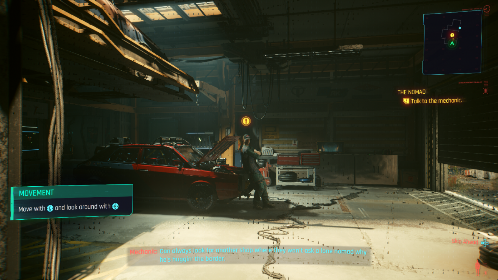
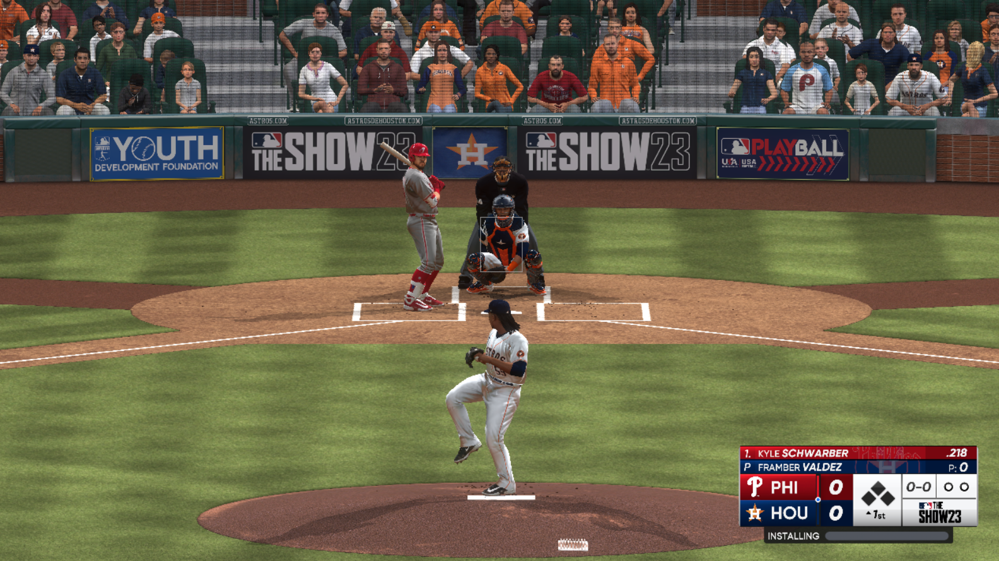

# KytyPS5-nhl

A private working fork of [KytyPS5](https://github.com/KytyPS5/KytyPS5) focused on getting **EA Sports NHL 27**
(PPSA34063, v01.003.001) and **NHL 26** (PPSA26785) running well. The working branch is `nhl26`.

> [!IMPORTANT]
> Not affiliated with Sony Interactive Entertainment, PlayStation or Electronic Arts. No game files or
> system software are distributed. Use only game files you have obtained legally.

## Status (2026-10-10)

| | NHL 27 | NHL 26 |
|---|---|---|
| Boots to menus | Yes | Yes |
| Franchise / Play Now menus | Yes | Yes |
| Loads into a match | Yes | Yes (slow) |
| Player / scene lighting | **Fixed** (front-face encoding) | **Fixed** (same fix) |
| Commentary audio | Working (Opus multistream fix); some lines still garbled | – |
| Save / profile | Working | – |

## Performance

FPS ranges in normal play mode (no profiler or debug logging), measured after the lighting fix.

| Scene | RX 6800 XT, Ryzen 5 5600 32 GB DDR4-3200| RX 9060 XT, Ryzen 5 9600x|
|---|---|---|
| Main menu (game caps at 30) | 26-30| 30 |
| Franchise menus (game caps at 30) | 30 | 30 |
| Team select | 18-26 | ? |
| In match | 12-19 | 22-28 |
| Free skate | 34-39 | 49-56 |

Fps is mainly limited by CPU-side per-draw preparation (descriptor/resource setup). Newer CPU's will preform better due to
greater single thread performance.

## Known bugs

- **Jersey cloth glitches**
- **Some skin tones look wrong in cut-scenes**
- **Occasional crashes**
- **Blurry facial hair**
- **Bright pixels**
- **Scrambled team logos**
- **Volume normalization issues**

## Notable fixes in this fork

- **Lighting (both games):** the pixel-shader front-face input now follows `SPI_BARYC_CNTL.FRONT_FACE_ALL_BITS`
  (integer 1/0 instead of float ±1). The lighting's `== 0` test never passed before, so direct light was
  never applied (players and floor were dark). Found by Cryan.
- **Commentary audio:** AJM Opus (codec 24) with a 2-byte LE length prefix. 2-channel instances are two uncoupled
  mono streams (self-delimited stream 0 + stream 1) whose TOC configs can differ.
- **Shader recompiler:**
  - partial-wave reductions (float-compare exec-bounded);
  - DPP/permlane inactive-lane preservation;
  - workgroup buffer sync;
  - bounded `S_SETPC` jump tables;
  - loop cap for runaway lighting loops (38 ms → 1.7 ms per draw);
  - memoized exponential recursion in resource materialization.
- **GPU / renderer:**
  - native indirect draws;
  - read-only buffer and BDA dirty caches;
  - program resource cache;
  - D16 depth sampled as R16;
  - D32 placeholders for depth-compare null slots;
  - BC6H storage-write redirect;
  - ignored LS/ES RSRC registers.
- **AMD driver crash:** Kyty's 3D detiler shader used an `OpSpecConstantOp Select` chain that crashes amdvlk.
  It is rewritten as if/return.
- **NHL 26 boot:** `param.json` missing from dumps (use `target-param.json`), and `--redzone` to stop host exception
  dispatch from clobbering the SysV red zone.
<table align="center">
  <tr>
    <td align="center">
      <strong>Cyberpunk 2077</strong><br>
      
    </td>
    <td align="center">
      <strong>MLB The Show 23</strong><br>
      
    </td>
  </tr>
  <tr>
    <td align="center">
      <strong>Astro Bot</strong><br>
      
    </td>
    <td align="center">
      <strong>Saros</strong><br>
      
    </td>
  </tr>
  <tr>
    <td align="center">
      <strong>Neptunia ReVerse</strong><br>
      
    </td>
    <td align="center">
      <strong>SILENT HILL: The Short Message</strong><br>
      
    </td>
  </tr>
  <tr>
    <td align="center">
      <strong>Demon's Souls</strong><br>
      
    </td>
    <td align="center">
      <strong>UFC 6</strong><br>
      
    </td>
  </tr>
</table>

## Running NHL 27

Build `kyty_emulator` (see the upstream build instructions below), then run:

```powershell
kyty_emulator.exe --game "<path>\eboot.bin" --screen-width 1920 --screen-height 1080 --redzone --readback-linear-images true
```

Enable `--readback-linear-images true` for NHL 27, including ONES mode. The option defaults to
`false` in `src/common/emulatorConfig.h`. With readback disabled, ONES outdoor gameplay was severely
overexposed (almost entirely white), while regular arena gameplay appeared normal. Enabling it
restored normal ONES lighting in a 1080p A/B test with the other settings unchanged.

This option copies GPU-written linear images back to guest memory. The affected ONES capture
included a one-pixel luminance result with no download transfer, consistent with missing exposure
feedback. No shader brightness adjustment was needed.

Recommended environment variables (all are needed for current performance and stability):

```
KYTY_DBG_LOOP_CAP=1024
KYTY_DBG_SKIP_BAD_SHADERS=1
KYTY_PIPELINE_CACHE_DIRTY=1
KYTY_EOP_DIRECT_LABELS=1
KYTY_NATIVE_INDIRECT=1
KYTY_READONLY_BUFFERS=1
KYTY_CLEAR_REGISTER_WIDE=1
KYTY_PARTIAL_WAVE_REDUCTION=1
KYTY_DPP_PRESERVE_INACTIVE=1
KYTY_WORKGROUP_BUFFER_SYNC=1
KYTY_BDA_DIRTY_CACHE=1
KYTY_PROGRAM_RESOURCE_CACHE=1
KYTY_PERF_NO_SYNC_READBACK=1
```

Performance switches measured on NHL 27 (`docs/claude-nhl27.md` has what each does):

```
KYTY_READBACK_QUEUE=1
KYTY_DIRECT_EOP_INTERRUPTS=1
KYTY_LONG_BUFFER_GC_AGE=1
KYTY_SPARSE_BUFFER_GC=1
KYTY_PM4_WRITE_DATA_FAST=1
KYTY_FALSE_SHARE_READS=1
KYTY_ASYNC_SUBMIT=1
KYTY_LAZY_SHARED_WRITES=1
KYTY_FAULT_PAGE_READS=1
KYTY_GPU_COLOR_CLEAR=1
KYTY_ASYNC_GUEST_READS=1
KYTY_BDA_DIRTY_REGIONS=1
KYTY_NATIVE_FP16=1
```

Building with `-DKYTY_PGO=use` (clang-cl 22.1.8) adds about 15% from the NHL 27 gameplay profile in
`tools/pgo`.

Useful debug options:

| Variable | What it does |
|---|---|
| `KYTY_PERF_GPU_TIMING=1` | Per-shader GPU timing (`NHL27GPU` lines); slows the game |
| `KYTY_DBG_FRAME_DUMP=1` | Press **F2** to dump the next frame to `captures/frame_N` (command list, image stats, buffers) |
| `KYTY_DBG_FRAME_DUMP_BUF_PS=<ps hashes>` | Also dump buffers, 3D images, SRT and push constants for those pixel shaders |
| `KYTY_DBG_TRACE_CS=<cs hashes>` | Log bindings for those compute dispatches |
| `KYTY_DBG_TRACE_WRITES=<addrs>` | Log GPU writes to those guest addresses |
| `KYTY_DBG_DUMP_SHADERS=<hashes>` | Dump shader binaries and SPIR-V |
| `KYTY_DBG_SKIP_CS` / `KYTY_DBG_SKIP_PS=<hashes>` | Skip shaders, for A/B tests |
| `KYTY_DBG_FORCE_SHADOW_COMPARE=always` | Force every depth-compare sampler to "lit" (diagnostic) |
| `KYTY_DBG_DEPTH_ALIAS=1` (+`_ADDR=`) | Log depth/texture aliasing events |

## Credits

- [KytyPS5](https://github.com/KytyPS5/KytyPS5) and the original [Kyty](https://github.com/InoriRus/Kyty).
- Cryan ([GitColeS](https://github.com/GitColeS)): front-face lighting fix and testing.
- Petr ([petrmolek]https://github.com/petrmolek): Performance development
- Toucann ([MrToucann]https://github.com/MrToucann): Performance development
- AnyPS5 developers, for comparison data on the lighting defect.

## Building

Build exactly as upstream KytyPS5: Windows with clang-cl + Ninja + Qt 6. See the
[upstream README](https://github.com/KytyPS5/KytyPS5#building). Quick version (Windows, x64 Native Tools prompt):

```powershell
git submodule update --init --recursive
cmake -S . -B _Build/windows -G Ninja -DCMAKE_BUILD_TYPE=Release -DCMAKE_C_COMPILER=clang-cl -DCMAKE_CXX_COMPILER=clang-cl -DCMAKE_PREFIX_PATH="C:/Qt/6.x.x/msvc2022_64"
cmake --build _Build/windows --target kyty_emulator
```

Build the launcher and stage a runnable installation:

```powershell
cmake --build _Build/windows --target launcher
cmake --install _Build/windows --prefix _Build/windows/install
```

The finished application and its runtime dependencies will be placed in
`_Build/windows/install`.

### Building on Linux

Install the toolchain and the libraries the bundled SDL3 needs. Without the audio, Wayland, and
udev development packages, SDL3 quietly configures itself without those backends, and the resulting
build has no working audio or gamepad hotplug support:

```bash
sudo apt-get install --no-install-recommends \
  clang lld ninja-build cmake git glslang-tools python3 pkg-config \
  libgl1-mesa-dev libx11-dev libxcursor-dev libxext-dev libxfixes-dev \
  libxi-dev libxrandr-dev libxss-dev libxtst-dev libxkbcommon-dev \
  libasound2-dev libpulse-dev libudev-dev libdbus-1-dev libwayland-dev wayland-protocols
```

Qt 6 (Concurrent, Network, and Widgets) is required for the launcher. Use your distribution's
packages (`qt6-base-dev`) or an official Qt installation.

```bash
git submodule update --init --recursive

cmake -S . -B _Build/linux -G Ninja -DCMAKE_BUILD_TYPE=Release \
  -DCMAKE_C_COMPILER=clang -DCMAKE_CXX_COMPILER=clang++ \
  -DCMAKE_PREFIX_PATH="$Qt6_DIR"

cmake --build _Build/linux --target launcher --parallel
cmake --install _Build/linux --prefix _Build/linux/install
```

The install step copies the Qt libraries and plugins next to the binaries, so
`_Build/linux/install` runs without a matching system Qt installation. FFmpeg is linked statically
from the pinned [KytyPS5 FFmpeg core](https://github.com/KytyPS5/ext-ffmpeg-core)
release, including VP9 and WebM support. System FFmpeg packages are not required.

To build `kyty_emulator` and the `kyty_tests` target without Qt, use a separate build directory:

```bash
git submodule update --init --recursive

cmake -S . -B _Build/linux-no-qt -G Ninja -DCMAKE_BUILD_TYPE=Release \
  -DCMAKE_C_COMPILER=clang -DCMAKE_CXX_COMPILER=clang++ \
  -DKYTY_BUILD_LAUNCHER=OFF

cmake --build _Build/linux-no-qt --target kyty_emulator kyty_tests --parallel
```

As on Windows, the MSVC compiler is not used; Clang is required. `cl.exe` is rejected at configure
time.

The CMake source root is the repository root.

### Building on NixOS

A development shell provides Clang, CMake, Ninja, Qt 6, the Vulkan headers, and the SDL3 backend
libraries. Enter it and configure exactly as on other Linux distributions; the shell exports
`CMAKE_PREFIX_PATH` and `QT_PLUGIN_PATH`, so the `-DCMAKE_PREFIX_PATH="$Qt6_DIR"` argument is not
needed:

```bash
nix-shell # or: nix develop
git submodule update --init --recursive

cmake -S . -B _Build/linux -G Ninja -DCMAKE_BUILD_TYPE=Release \
  -DCMAKE_C_COMPILER=clang -DCMAKE_CXX_COMPILER=clang++

cmake --build _Build/linux --target launcher --parallel
cmake --install _Build/linux --prefix _Build/linux/install
```

The configure step downloads the FFmpeg prebuilts and the `xbyak`, `zydis`, `zstd`, and ZArchive
sources, so it needs network access; a fully sandboxed `nix build` would require vendoring those
inputs. A Vulkan 1.3 driver must be available at runtime (on NixOS,
`hardware.graphics.enable = true`).

### Building on Fedora and Fedora Atomic (Bazzite, Bluefin, Silverblue)

On regular Fedora, install dependencies on the host. On Fedora Atomic variants such as Bazzite,
Bluefin and Silverblue, use [Distrobox](https://distrobox.it/) and run the install and build steps
inside the container. Keep the checkout in your home directory so it is shared with the container.
Add `--nvidia` to the create command for hosts using the proprietary NVIDIA driver:

```bash
distrobox create --name kyty-build --image registry.fedoraproject.org/fedora:latest
distrobox enter kyty-build
```

Install the toolchain, Qt 6 and SDL3 dependencies:

```bash
sudo dnf install -y \
  clang lld ninja-build cmake git glslang python3 pkgconf-pkg-config \
  mesa-libGL-devel libX11-devel libXcursor-devel libXext-devel libXfixes-devel \
  libXi-devel libXrandr-devel libXScrnSaver-devel libXtst-devel libxkbcommon-devel \
  alsa-lib-devel pulseaudio-libs-devel systemd-devel dbus-devel \
  wayland-devel wayland-protocols-devel qt6-qtbase-devel
```

From the repository root, follow the launcher configure, build and install steps in
[Building on Linux](#building-on-linux), omitting `-DCMAKE_PREFIX_PATH="$Qt6_DIR"`; CMake finds
Fedora's packaged Qt 6 automatically.

Run `./_Build/linux/install/kyty_launcher` on regular Fedora or inside the container. To launch a
container build from the host, leave the container with `exit`, then run from the repository root:

```bash
distrobox enter kyty-build -- ./_Build/linux/install/kyty_launcher
```

Qt libraries and plugins are bundled. You can also launch directly on a Fedora Atomic host
if its other system libraries are compatible with the container build.

### Building on macOS

macOS builds target x86-64 and run under Rosetta 2 on Apple Silicon, so the PS5's x86-64 game
code executes through the same translation layer as the emulator itself. Prebuilt archives are
attached to releases; the steps below are for building from source.

Requirements:

- An Apple Silicon Mac with Rosetta 2 installed (`softwareupdate --install-rosetta`)
- Xcode (or the Command Line Tools)
- Homebrew packages: `brew install cmake ninja glslang python`
- Qt 6 (Concurrent, Network, and Widgets) with x86-64 support. The official Qt installation is
  universal and works; Homebrew's Qt is arm64-only and will not link

```bash
git submodule update --init --recursive

cmake -S . -B _Build/macos -G Ninja -DCMAKE_BUILD_TYPE=Release \
  -DCMAKE_OSX_ARCHITECTURES=x86_64 \
  -DCMAKE_C_COMPILER=clang -DCMAKE_CXX_COMPILER=clang++ \
  -DCMAKE_PREFIX_PATH="$Qt6_DIR"

cmake --build _Build/macos --target launcher --parallel
cmake --install _Build/macos --prefix _Build/macos/install
```

The build re-signs `kyty_emulator` with the JIT entitlements it needs to execute translated
guest code; no manual signing step is required. When the launcher is built, the installation
also produces `_Build/macos/install/KytyPS5.app` — double-click to launch the GUI.
A flat `kyty_emulator` is kept for CLI usage.

Vulkan comes from MoltenVK. Download `MoltenVK-macos.tar` from the
[MoltenVK releases](https://github.com/KhronosGroup/MoltenVK/releases), then copy
`MoltenVK/dynamic/dylib/macOS/libMoltenVK.dylib` next to the flat `kyty_emulator`
(and, for the bundle, into `KytyPS5.app/Contents/Frameworks/`) and sign it with an ad hoc signature:

```bash
codesign --force --sign - _Build/macos/install/libMoltenVK.dylib
# For the bundle (if present):
codesign --force --sign - _Build/macos/install/KytyPS5.app/Contents/Frameworks/libMoltenVK.dylib
codesign --force --sign - _Build/macos/install/KytyPS5.app
```

Release archives already include a signed `libMoltenVK.dylib` (both flat and inside the bundle).

### Regression tests

Build every regression executable and run the registered tests with:

```powershell
cmake --build _Build/windows --target kyty_tests
ctest --test-dir _Build/windows --output-on-failure
```

Use `_Build/linux` instead of `_Build/windows` for a Linux build.

### Visual Studio Code

A ready-made Visual Studio Code setup is included in [`.vscode`](.vscode). It configures CMake
Tools to build the project with Ninja and `clang-cl` and provides launch profiles for both
`kyty_launcher.exe` and `kyty_emulator.exe`. It is Windows-only: VS Code settings cannot select a
compiler per platform, so on Linux configure from the command line as shown above.

Before using it:

1. Install the **CMake Tools** and **C/C++** extensions in Visual Studio Code.
2. Update `CMAKE_PREFIX_PATH` in [`.vscode/settings.json`](.vscode/settings.json) to point to your
   Qt 6 MSVC installation.
3. Update the `--game` path in [`.vscode/launch.json`](.vscode/launch.json) for the
   **Debug kyty_emulator** profile.
4. Open the repository in an x64 Visual Studio developer environment, configure the CMake project,
   and select a launch profile from **Run and Debug**.

## Running

Update your graphics driver before reporting rendering problems.

To use the graphical launcher:

```powershell
.\_Build\windows\install\kyty_launcher.exe
```

```bash
./_Build/linux/install/kyty_launcher
```

```bash
open _Build/macos/install/KytyPS5.app  # or double-click in Finder
```

On first launch, add one or more game folders in the global settings. The launcher searches those
folders recursively for game directories containing `eboot.bin` and ZArchive (`.zar`) game dumps
whose archive root contains `eboot.bin`. Select a detected game and run it from the game list.
ZArchive dumps are mounted read-only and streamed directly; they do not need to be extracted first.

Official release builds include a built-in updater. Leave **Check for updates on startup** enabled,
or click **Check for updates**, then choose **Install Update**. The launcher downloads the package
for your platform from GitHub, checks its SHA-256 checksum, and restarts after installation. Close
any running games first. Settings, saves, patches, and other files outside the release package are
preserved; replacement failures restore the previous files. The installation folder must be writable.
If a package cannot be installed automatically, the updater offers the GitHub release page.
Source builds and builds from forks do not replace themselves with official releases.

The emulator can also be started directly with a legally obtained game directory, ELF file, or
ZArchive dump:

```powershell
.\_Build\windows\install\kyty_emulator.exe --game "D:\Games\ExampleGame"
.\_Build\windows\install\kyty_emulator.exe --game "D:\Games\ExampleGame.zar"
```

```bash
./_Build/linux/install/kyty_emulator --game "/games/ExampleGame"
./_Build/linux/install/kyty_emulator --game "/games/ExampleGame.zar"
```

On macOS, the adjacent flat or app-bundled `libMoltenVK.dylib` is found automatically; no
environment variable is required:

```bash
./_Build/macos/install/kyty_emulator --game "/games/ExampleGame"
```

To override the Vulkan loader, set `SDL_VULKAN_LIBRARY`:

```bash
SDL_VULKAN_LIBRARY=/path/to/libMoltenVK.dylib ./kyty_emulator --game "/games/ExampleGame"
```

Run `kyty_emulator --help` to see the available graphics, logging, validation, profiling, and
debugging options.

### AI Use

AI tools may be used for research, reverse engineering, and development assistance. Contributors
must fully understand, review, and test all code they submit and remain responsible for its
correctness. Repository communication, including pull-request descriptions, code comments, and
issue comments, must come from the human contributor rather than an autonomous AI agent.

Pull requests that include AI-assisted or AI-generated work should disclose the scope of the AI
involvement and describe the human review and testing performed before submission. Unverified or
untested generated changes may be closed without review.

## License

KytyPS5 is licensed under the [GNU General Public License version 2](LICENSE) (`GPL-2.0-only`).
It is based on the original [Kyty](https://github.com/InoriRus/Kyty) (MIT). Kyty's notice is preserved in
[`LICENSES/Kyty-MIT.txt`](LICENSES/Kyty-MIT.txt). Third-party components remain under their own licenses.
